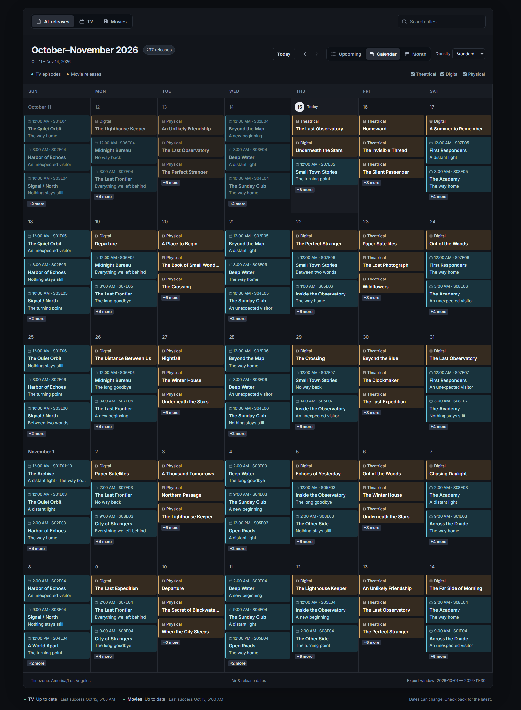

# Calendar

A TV and movie release calendar powered by Sonarr and Radarr. One Node.js container runs TanStack Start and a background poller. No database or authentication. Only explicitly allowlisted, validated event fields reach the browser.



## Demo and local development

Use Node.js 24 and pnpm 10.28.2:

```sh
corepack enable
corepack prepare pnpm@10.28.2 --activate
pnpm install --frozen-lockfile
pnpm dev:demo
```

Demo mode uses fictional data without reading upstream configuration or keys. `pnpm dev` uses runtime settings from the ignored root `.env`. Neither command writes static demo files. Real-data mode never falls back to demo data.

## Configuration

For a new installation, copy `.env.example` to `.env` **only if `.env` does not already exist**, then edit it privately. Remove unused source settings. Use `SONARR_URL`/`RADARR_URL` and `*_API_KEY`, or `*_API_KEY_FILE` for mounted key files. Never use `VITE_*`, build arguments, or image layers for secrets. Environment settings are read at server startup; restart after changes.

The example publishes nothing until you remove the empty `*_ALLOW_IDS` lines or enter comma-separated IDs (Sonarr series IDs; Radarr movie IDs). `*_MONITORED_ONLY=true` limits publication to monitored items. Env-based sources default to monitored-only. Existing JSON policies remain unchanged.

`REFRESH_INTERVAL_MINUTES=15`, `DAYS_BACK=30`, `DAYS_AHEAD=180`, and `REQUEST_TIMEOUT_MS=10000` are the defaults. Both sources refresh on startup, independently, with at most three bounded attempts. Refreshes never overlap. Sanitized per-source state and atomic snapshots persist across restarts. Failed sources are stale when cached data is usable, otherwise unavailable. Policy/upstream changes invalidate incompatible caches.

`CALENDAR_CONFIG` (or legacy `EXPORTER_CONFIG`) accepts the existing private exporter JSON unchanged; environment values override it. `PUBLIC_CONFIG_FILE` optionally points to a validated JSON file matching `deployment/public-config.example.json` for title, timezone, and request link. Both files stay outside browser assets. With no public-config file, built-in defaults apply. With no sources, the API reports unavailable sources and no events.

## Deploy

Run from the repository root:

```sh
mkdir -p runtime/public runtime/private-state
# Match these ownership values to CALENDAR_UID/CALENDAR_GID if customized.
sudo chown 1000:1000 runtime/public runtime/private-state
chmod 700 runtime/private-state
docker compose -p edoncloud-calendar -f deployment/compose.yaml up -d --build
```

Do not change existing storage ownership blindly during migration; use the previous exporter UID/GID. The container runs without root, capabilities, or a writable root filesystem. Only persistent data directories and `/tmp` are writable.

The address remains `http://127.0.0.1:8080`. Add an ignored `deployment/compose.local.yaml` for existing LAN bindings, tunnel networks, or secret mounts, and append `-f deployment/compose.local.yaml` to commands. The app retains the `frontend` network and `web`/default previous container-name aliases. Keep your existing tunnel destination and external port; see [migration](docs/migration.md) for override mapping.

This is a **single-instance** application: run one process/container against these directories. The Nitro startup plugin owns one polling loop and drains active refreshes on shutdown (210-second Compose grace period). `/healthz` checks the polling/storage lifecycle; upstream outages appear in `/data/calendar.json`, not as container failures. The initial HTML includes the validated public configuration and cached snapshot from memory, seeding the browser query cache without initial JSON requests. The grid still renders in the browser, respecting saved views and local timezones. The browser polls the validated endpoint every 60 seconds; if initial data is unavailable, it falls back to fetching it. A snapshot not yet available returns generic JSON with HTTP 503; unknown data paths return 404 and unsupported methods return 405.

For production without Docker:

```sh
pnpm build
pnpm start
```

Set `HOST=127.0.0.1` and `PORT=8080` in `.env` for that local command. Runtime paths default to `runtime/public` and `runtime/private-state` relative to the working directory. The supported server is `node apps/web/.output/server/index.mjs`, not Vite preview. This follows [TanStack Start's Nitro deployment guide](https://tanstack.com/start/latest/docs/framework/react/guide/hosting); the lockfile pins the documented Nitro Vite adapter (currently version `3.0.260903-beta`).

## Updates

Back up private configuration and runtime directories with your usual private backup process. Keep the current image for rollback, then:

```sh
docker image tag calendar-app:local calendar-app:rollback
git pull --ff-only
docker compose -p edoncloud-calendar -f deployment/compose.yaml -f deployment/compose.local.yaml up -d --build
```

Omit the second `-f` if unused. To roll back an app update:

```sh
docker image tag calendar-app:rollback calendar-app:local
docker compose -p edoncloud-calendar -f deployment/compose.yaml -f deployment/compose.local.yaml up -d --no-build --pull never
```

Do not prune images or remove runtime directories. For the first migration from two containers, use [the migration and rollback commands](docs/migration.md).

## Unraid icon

Set `CALENDAR_ICON_URL` in `.env` to your public PNG URL. After starting the single app service:

```sh
bash deployment/install-unraid-icons.sh https://example.com/calendar.png
```

The script installs template metadata for `app`, preserves existing templates, and does not deploy anything. Continue managing updates with Compose. Existing exporter/web templates can remain for rollback.

## Checks

```sh
pnpm build
pnpm lint
pnpm typecheck
pnpm test
pnpm test:production
pnpm format:check
pnpm scan
```

Gitleaks is required for `pnpm scan`; it scans publishable source, Git history, and browser assets without opening ignored private files. `pnpm test:production` launches temporary loopback services using only synthetic data. For browser tests, run the built app with explicit `CALENDAR_DEMO=true` on port 8080, install Playwright Chromium, and run `pnpm test:e2e`. CI also builds and tests the single production image; it does not deploy.

No application license selected yet. Bundled component notices are in `licenses/`.
